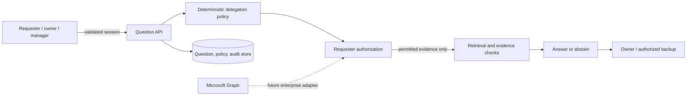

# Human API security architecture

Review date: 26 October 2026. Prototype only. This describes the design and test coverage; it is not a security certification.

## Plain-language summary

Human API checks two different permissions before it uses a file:

1. **Did the knowledge owner agree to this kind of help?** This limits the dates, project, topic, audience, files and backup person.
2. **Can the requester open this file already?** If not, the file cannot be used to answer the question.

The first check does not replace the second. For example, Bob can opt in to help with Project Alpha questions, but Alice still cannot see a restricted budget file that only a manager may open. Human API returns a general denial without exposing the file name, contents or amount.

If an answer is shown, its source access is checked again when the requester opens it. If access was removed, the saved answer and citations are hidden. For the project terms “requester,” “owner,” “evidence” and “AI agent,” see the [reader guide](READER_GUIDE.md).

## Trust boundaries

Identity, owner consent and file access are separate decisions. Owner consent allows the app to perform a limited workflow; it does not grant the requester access to the owner's files. The app checks the requester's file permissions before searching or ranking content. When an answer is opened later, the app checks those permissions again and hides the saved answer and citations if access has been removed.

## Controls implemented in the MVP

- The fictional identity switch works only in local demo mode; demo people, files and availability are clearly examples.
- A future enterprise setup must verify Microsoft's signed work-account token and confirm the employee is registered. Question submission stays disabled until Microsoft file search is connected and tested.
- Project, topic, audience, source and active-date policy checks; manager approval required.
- Default deny for unknown users, non-members and inaccessible questions. Hidden resources return 404.
- Use only approved active files the requester may open; filter access before matching words or showing citations.
- Generic access denial does not echo restricted document title, content or existence.
- The app marks software-produced answers “AI-generated” to distinguish them from human replies; the local text uses fixed templates and no language model. Insufficient or conflicting evidence escalates.
- Owner correction does not become reusable until separately approved.
- The demo removes a small set of known hostile instruction phrases from file text. This is a narrow safeguard, not a general defense against instructions hidden in documents.
- The audit log records who took an action, what kind of record it affected and whether access was allowed. The demo admin view shows counts and audit details, not unrestricted file contents.
- Sign-in tokens are not written to logs; no real messages are sent.

## Threats and required production controls

| Risk | What the demo does | What a real service would still need |
|---|---|---|
| Someone fakes a demo identity | Demo identity is accepted only in local demo mode. | Real work sign-in, browser-session protection and required company sign-in controls. |
| The owner's access is used for the requester | Adapter design calls for the requester's own access. The full Microsoft flow is not connected yet. | End-to-end tests proving every file lookup uses the requester's Microsoft permissions. |
| Access is removed after an answer | Project access and citations are checked again when the saved answer is opened. | Live permission checks or short-lived caches with reliable access-removal handling. |
| One user or company sees another's data | The demo uses fictional data from one sample organization. | Organization/user separation in every query, automated isolation checks and encryption keys. |
| A denial reveals a hidden file | The demo returns a general denial without a title, excerpt or confirmation that the file exists. | Review for indirect leaks, sensitive labels and side channels. |
| A document tries to control an AI | The demo removes a few known hostile phrases. | Treat every file as untrusted, restrict tools and test many hostile examples. |
| A human reply races the timeout worker | Conditional state changes prevent ordinary duplicate outcomes in the single-process demo. | Multi-server concurrency tests, worker ownership/locking and reliable notification delivery. |
| An administrator reads private content | The demo governance screen shows counts and audit details, not question contents. | Separate, logged emergency access with explicit approval. |
| Data stays longer than approved | Only fictional local data is included. | Approved retention/deletion rules, backup expiry and legal-hold handling. |
| Secrets or sign-in tokens leak | No credentials or raw tokens are stored in the repository or normal app records. | Managed secrets, encrypted connections, key rotation and monitored, redacted logs. |

## Data handling

Demo labels are examples; they do not match Presight's official information labels. Do not import Microsoft content or personal information. Before a pilot, map the organization's real file labels and rules. The adapter design keeps tokens in memory for a request; raw tokens must never be saved or logged. This app does not encrypt its local SQLite database.

## Incident and assurance work before pilot

Before a pilot, assess what personal or sensitive data could be used and how attackers might expose it. Decide how long information is kept and who supports the service. Run independent tests of file access, organization separation, hostile documents and simultaneous requests. Verify Microsoft permissions and approvals. Define who responds to incidents, how audit logs and backups are protected, and how the system is recovered. Presight Security and Privacy teams must review readiness.
